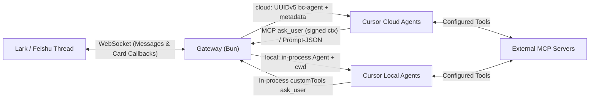

# cursor-agent-lark

[中文](./README.zh-CN.md) | English

A multi-bot **Lark / Feishu** gateway for **Cursor Agents** (Cloud & Local runtimes) built with TypeScript and Bun. Supports thread-based agent sessions, multi-turn follow-ups and steering, human-in-the-loop (HITL) questions, and multiple MCP servers.



## Quick Start

Use Bun 1.4.5, matching the version pinned in `package.json` and Docker.

```bash
bun install
cp config.example.toml config.toml
cp .env.example .env
bun run start
```

For a single-bot setup, you can omit the config file and set `LARK_APP_ID`, `LARK_APP_SECRET`, and `CURSOR_API_KEY` in `.env`.

## Configuration

Only TOML configuration files are supported. The gateway automatically loads `config.toml`, or a file explicitly selected via `--config <path>` / `CONFIG_PATH`. All string values support `${ENV_VAR}` expansion.

- **Multiple Bots & Dual Runtime**: Define bots via `[[bots]]` in TOML. Each bot maintains its own WebSocket connection and can choose `runtime` (`cloud` or `local`) and override `domain`, `require_mention`, `cwd`, `default_repo`, `default_model`, `cursor_api_key`, `allowed_users`, and `mcp_servers`.
- **Multiple MCP Servers & HITL**: Configure external `http` / `sse` / `stdio` MCP servers globally (`mcp.servers`) or per bot (`bots[].mcp_servers`). Local bots get an in-process `ask_user` tool automatically; cloud bots use `POST /mcp` when `mcp.public_url` is set (otherwise Prompt-JSON HITL fallback).
- **Stateless Cloud Mode**: Cloud runtime requires no database or persistent volume (thread-to-agent UUIDv5 `bc-<uuid>` + Cursor `cloud.metadata` + signed card/MCP callbacks). Local runtime runs directly against configured `cwd` / alias `path` using `@cursor/sdk`'s local store.

### Bot Preset Prompts and Repositories

Set `preset_prompt` in each `[[bots]]` block (TOML multiline strings and environment expansion are supported). The gateway prefixes the initial session creation request with these instructions (not repeated on follow-ups, Steer instructions, or question answers). Missing or empty values preserve existing behavior. This is prompt content, not a separate SDK system role or an authorization boundary.

- **No repository**: a Cloud bot can set `default_repo = ''` and `allow_no_repo = true`. An empty default clears the inherited global repository. The example config requires a repository unless explicitly changed.
- **Multiple repository choices**: global and per-bot `repos.aliases` can list multiple repositories; select one with `repo: <alias>` in a message. Each Cloud session currently receives only one repository, not multiple simultaneous Cloud repositories.
- **Multiple local directories**: a Local bot uses `cwd` as its primary directory and `dirs = ['/path/to/another-repo']` for additional directories. They need not be Git repositories, but must exist and be accessible; `default_model` is still required.

### Lark Open Platform Setup

For each bot app:

1. Enable the **Bot** capability.
2. Grant permissions: `im:message`, `im:message:send_as_bot`, `im:message.p2p_msg:readonly`, `im:message.group_at_msg:readonly`, `im:message.group_msg`.
3. Set both **Event Subscriptions** and **Callbacks** to **Long Connection**, and subscribe to `im.message.receive_v1` and `card.action.trigger`.

## Chat Usage

- **Start a Session (Thread)**: Mention `@Bot` in a group chat with structured fields (`repo`, `branch`, `model`, `mode`, `pr`, `task`) or plain text (uses the bot's `default_repo` or local `cwd`). The bot replies in a **thread** and creates a Cursor Agent (**one thread = one Agent session**).
- **Follow-Up / Steer**: Send any message directly inside the session thread to continue the same Agent without `@Bot` (steers if running, starts a follow-up run if idle), or use `/steer <text>` and `/followup <text>` in the thread or DM.
- **Answer Agent Questions**: Question cards are posted in the same thread with numbered options and a custom input field as the last item. Click an option, submit the input, or reply directly in the thread.
- **Commands**: `/status`, `/cancel`, `/list`, `/repos`, `/models`, `/help` (inside a session thread, `/status`, `/cancel`, `/steer`, and `/followup` work without `@Bot` or an agent ID).

## Library Usage (Bun)

You can also import this repository as a Bun library (`src/lib.ts`) to supply configuration from an external config center or embed the gateway inside another service:

```ts
import { createGateway, parseConfigFromObject, parseConfigFromToml } from 'cursor-agent-lark'

// Parse from a TOML string or plain JS object (host env overrides are off by default)
const cfg = parseConfigFromToml(remoteTomlText, { env: process.env })
// or: const cfg = parseConfigFromObject(remoteJsonConfig, { env: process.env })

const gateway = createGateway(cfg, {
  // Optional: set false to mount `gateway.handleRequest` / `gateway.mcpHandler` in your own HTTP server
  startHttpServer: true,
})

await gateway.start()

// On remote config updates, validate the new config first, then stop() and recreate the gateway
await gateway.stop()
```

## Development

Type checking uses TypeScript 7.0.2 (`tsc`). Oxlint handles code checks, and Oxfmt handles formatting and import sorting. Pre-commit hooks also validate TOML/JSON/YAML syntax.

```bash
bun run dev          # Watch mode
bun run check        # Oxlint + Oxfmt + TypeScript typecheck + Bun tests
bun run lint:fix     # Auto-fix supported lint issues
bun run format      # Format code and sort imports
prek install         # Install Git pre-commit hooks
```

## License

MIT. See [LICENSE](LICENSE).
