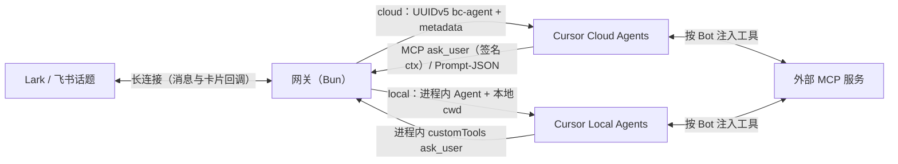

# cursor-agent-lark

中文 | [English](./README.md)

基于 TypeScript + Bun 的 Cursor Agents（同时支持 Cloud 与 Local runtime）× Lark 多机器人网关，支持话题级 Agent 会话、多轮追问与 Steer、人工确认反问（HITL）及多 MCP 服务注入。



## 快速开始

使用 Bun 1.4.5，与 `package.json` 和 Docker 中固定的版本保持一致。

```bash
bun install
cp config.example.toml config.toml
cp .env.example .env
bun run start
```

也可以仅配置 `.env` 中的 `LARK_APP_ID`、`LARK_APP_SECRET`、`CURSOR_API_KEY` 启动单机器人。

## 配置说明

仅支持 TOML 配置文件。默认自动加载 `config.toml`，也支持 `--config <路径>` 或 `CONFIG_PATH` 指定。所有字符串均支持 `${环境变量名}` 展开。

- **多机器人与双 Runtime**：通过 TOML 的 `[[bots]]` 定义多个机器人，每个机器人独立维护长连接，可独立选择 `runtime`（`cloud` / `local`），并覆写 `domain`、`require_mention`、`cwd`、`default_repo`、`default_model`、`cursor_api_key`、`allowed_users` 与 `mcp_servers`。
- **多 MCP 服务与 HITL**：在全局 `mcp.servers` 或单机器人 `bots[].mcp_servers` 中配置多个 `http` / `sse` / `stdio` 类型的 MCP 服务；`local` 机器人自动注入进程内 `ask_user` 工具（无需公网地址），`cloud` 机器人配置 `mcp.public_url` 启用 `/mcp`（否则自动使用 Prompt 结构化反问）。
- **无状态 Cloud / 本地 Local**：`cloud` 模式无需任何数据库或持久化卷（话题 UUIDv5 映射 + Cursor `cloud.metadata` + 签名回调）；`local` 模式直接操作本地 `cwd` / 仓库别名 `path`，由 `@cursor/sdk` 本地存储管理会话。

### Bot 预制 Prompt 与仓库

在每个 `[[bots]]` 中设置 `preset_prompt`（支持 TOML 多行字符串和环境变量展开）。网关仅会在创建会话的首轮请求中将其作为 Bot 指令前缀添加，后续追问、Steer 和反问答案不再重复附加；未配置或留空则保持原行为。它是发送给 Agent 的 prompt 内容，不是 SDK 的独立 system role，也不是权限隔离机制。

- **不绑定仓库**：Cloud Bot 可设置 `default_repo = ''`、`allow_no_repo = true`；空字符串会清除继承的全局默认仓库。示例配置默认要求仓库，需要显式修改。
- **多个候选仓库**：全局和 Bot 的 `repos.aliases` 可配置多个仓库，用消息中的 `repo: <别名>` 选择；当前 Cloud 会话一次只传入一个仓库，不支持同时挂载多个 Cloud 仓库。
- **多个本地目录**：Local Bot 使用 `cwd` 作为主目录，`dirs = ['/path/to/another-repo']` 可添加其他目录。目录不必是 Git 仓库，但必须存在且可访问；仍需要 `default_model`。

### Lark 开放平台配置

每个机器人应用需开启：

1. 启用「机器人」能力。
2. 开通权限：`im:message`、`im:message:send_as_bot`、`im:message.p2p_msg:readonly`、`im:message.group_at_msg:readonly`、`im:message.group_msg`。
3. 事件订阅与回调订阅均选择「长连接」，订阅 `im.message.receive_v1` 与 `card.action.trigger`。

## 聊天用法

- **创建会话（新话题）**：群聊中 `@机器人` 发送结构化指令（支持 `repo`、`branch`、`model`、`mode`、`pr`、`task`）或自然语言，机器人会在**话题中回复**并创建一个新的 Cursor Agent（**一个话题 = 一个 Agent 会话**）。
- **追问 / 插入指令**：直接在对应话题内继续发消息即可自动追问，无需 `@机器人`（运行中自动 Steer，结束后发起 Follow-up）；也可在话题或私聊内使用 `/steer <内容>`、`/followup <内容>`。
- **回答反问**：反问卡片会发送在同一话题中，支持编号选项与末项自定义输入；可点击选项、填写自定义输入框或直接在话题内回复文本。
- **其他命令**：`/status`、`/cancel`、`/list`、`/repos`、`/models`、`/help`（在会话话题内使用 `/status`、`/cancel`、`/steer`、`/followup` 均无需 `@机器人` 或填写 ID）。

## 作为库使用（Bun）

本仓库除支持直接通过 `config.toml` 独立启动外，也可作为 Bun 库（`src/lib.ts`）被外部项目引入，方便对接内部配置中心（如远程下发 TOML/JSON 配置并热重启）或嵌入现有服务：

```ts
import { createGateway, parseConfigFromObject, parseConfigFromToml } from 'cursor-agent-lark'

// 支持直接解析内存中的 TOML 文本或 JS/JSON 对象（默认不让宿主机环境变量静默覆盖远程配置）
const cfg = parseConfigFromToml(remoteTomlText, { env: process.env })
// 或：const cfg = parseConfigFromObject(remoteJsonConfig, { env: process.env })

const gateway = createGateway(cfg, {
  // 可选：设为 false 时不内置起端口，可直接把 gateway.handleRequest / gateway.mcpHandler 挂到已有 HTTP 服务
  startHttpServer: true,
})

await gateway.start()

// 配置变更时先校验新配置，再优雅停止旧实例并启动新实例
await gateway.stop()
```

## 开发命令

类型检查使用 TypeScript 7.0.2（`tsc`）。Oxlint 负责代码检查，Oxfmt 负责格式化和 import 排序。提交前钩子还会检查 TOML/JSON/YAML 语法。

```bash
bun run dev          # 开发模式（热重载）
bun run check        # Oxlint + Oxfmt + 类型检查 + 单元测试
bun run lint:fix     # 自动修复支持的检查问题
bun run format      # 格式化代码并排序 import
prek install         # 安装 Git 提交前检查钩子
```

## 许可证

MIT，详见 [LICENSE](LICENSE)。
